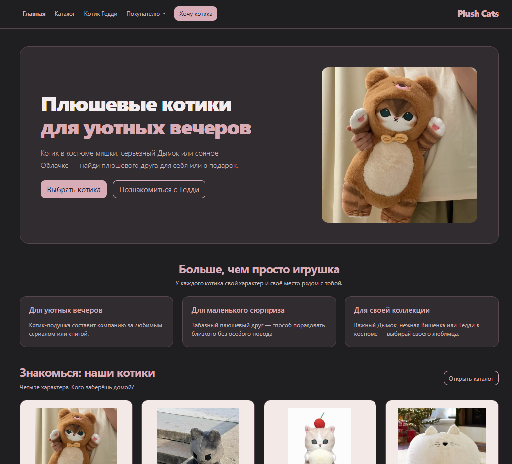

# Plush Cats — контрольная работа №2

Тема: «CSS-фреймворки: разработка интерфейса на Bootstrap или альтернативном CSS-фреймворке».

## Автор

ФИО: Сутормина Виктория  
Группа: ЭФБО-06-25

## Ссылка на сайт 
- https://vikki122222.github.io/kr2-bootstrap-shop/

## Описание проекта

Plush Cats — учебный интернет-магазин плюшевых котиков, разработанный с использованием Bootstrap.

На сайте представлены четыре товара: Тедди, Дымок, Вишенка и котик-подушка Облачко.

Пользователь может просмотреть каталог, выбрать категорию, открыть подробную страницу Тедди и заполнить форму заявки с расчётом суммы товаров.

Проект размещён в отдельном репозитории `kr2-bootstrap-shop`.

## Скриншот главной страницы

## Используемые технологии

- HTML5;
- CSS3;
- Bootstrap 5.3.8;
- JavaScript;
- Git и GitHub.

## Подключение Bootstrap

Bootstrap 5.3.8 подключён локально, без CDN.

Используются файлы:

- `vendor/bootstrap/css/bootstrap.min.css`;
- `vendor/bootstrap/js/bootstrap.bundle.min.js`.

Стили Bootstrap подключаются внутри `<head>`. Собственный файл `css/custom.css` подключается после Bootstrap и дополняет его оформление.

Bootstrap JS Bundle подключается перед закрывающим тегом `</body>` и обеспечивает работу интерактивных компонентов.

## Структура проекта

| Файл или папка | Назначение |
|---|---|
| `index.html` | Главная страница |
| `catalog.html` | Каталог товаров |
| `product.html` | Подробная страница котика Тедди |
| `order.html` | Форма заявки |
| `css/custom.css` | Собственное оформление поверх Bootstrap |
| `images/` | Фотографии товаров |
| `docs/homepage.png` | Скриншот главной страницы |
| `vendor/bootstrap/css/bootstrap.min.css` | Локальные стили Bootstrap |
| `vendor/bootstrap/js/bootstrap.bundle.min.js` | Локальный JavaScript Bootstrap |
| `README.md` | Описание проекта |
| `.gitignore` | Исключения для Git |

Собственные JavaScript-скрипты расположены внутри `catalog.html` и `order.html`.

## Реализованные страницы

### Главная — index.html

- общая навигация;
- hero-блок с фотографией;
- преимущества;
- популярные товары;
- подсказки по выбору подарка;
- подвал.

### Каталог — catalog.html

- адаптивная сетка из четырёх карточек;
- фотографии, описания и цены;
- значки особенностей товаров;
- фильтр категорий со счётчиком;
- модальное окно заявки с подстановкой выбранного котика.

### Страница товара — product.html

- фотография и описание Тедди;
- цена и кнопки действий;
- таблица характеристик;
- вкладки с описанием, характеристиками и идеями подарка;
- раскрывающиеся ответы на вопросы;
- переход к форме с предварительным выбором Тедди.

Отдельная страница подробного описания реализована для Тедди. Кнопки подробного описания остальных котиков неактивны.

### Заявка — order.html

- выбор котика и количества;
- имя, e-mail и телефон;
- комментарий;
- обязательное согласие;
- сводка с фотографией и стоимостью;
- проверка формы и очистка полей.

У полей есть `label` и `name`. Обязательные поля отмечены атрибутом `required`.

Форма демонстрационная: данные не отправляются на сервер и не сохраняются кодом приложения. Оплата и реальная обработка заказов не реализованы.

## Bootstrap-сетка

Используются классы:

- `container`;
- `row`;
- `col-12`;
- `col-md-*`;
- `col-lg-*`;
- `col-xl-*`;
- `g-*`.

Количество колонок изменяется в зависимости от ширины экрана. Для отступов и выравнивания применяются utility-классы Bootstrap.

## Реализованные Bootstrap-компоненты

| Компонент | Применение |
|---|---|
| `navbar` | Общая навигация и мобильное меню |
| `dropdown` | Меню «Покупателю» |
| `card` | Карточки товаров и сводка заявки |
| `btn` | Основные, контурные и неактивные кнопки |
| `badge` | Особенности товаров |
| `alert` | Информационные сообщения и результаты проверки |
| `modal` | Быстрая заявка из каталога |
| `form-control` | Текстовые поля и комментарии |
| `form-select` | Выбор категории и котика |
| `input-group` | Телефон с префиксом `+7` |
| `form-check` | Чекбокс согласия |
| `breadcrumb` | Хлебные крошки |
| `nav-tabs` | Вкладки страницы товара |
| `accordion` | Частые вопросы |

## Самостоятельные доработки

- Локальное подключение Bootstrap без CDN.
- Единая тёмная тема с розовыми акцентами.
- Фотографии и индивидуальные описания товаров.
- Дополнительный раздел с подсказками по выбору подарка.
- Фильтрация каталога по категориям со счётчиком карточек.
- Автоматический выбор котика в модальном окне.
- Передача выбранного товара через параметр ссылки.
- Расчёт суммы по цене и количеству.
- Обновляемая сводка с фотографией товара.
- Дополнительные вкладки на странице Тедди.
- Видимый фокус с клавиатуры и ссылка перехода к содержимому.
- Учёт настройки уменьшения движения при анимации.
- Подвал в потоке документа без перекрытия содержимого.

## Как запустить проект

1. Скачать или клонировать репозиторий.
2. Открыть папку проекта в WebStorm.
3. Открыть `index.html`.
4. Нажать `Alt + F2` и выбрать браузер.

Также сайт доступен по ссылке в разделе «Ссылки».

## Как проверить проект

1. Открыть все четыре страницы через меню.
2. Проверить раскрытие мобильного меню и списка «Покупателю».
3. В каталоге выбрать «Котики-подушки»: должно остаться Облачко.
4. Вернуть «Все котики»: должны появиться четыре карточки.
5. Нажать «Заказать» у Дымка и проверить выбранный товар в модальном окне.
6. Проверить закрытие модального окна.
7. На странице Тедди переключить вкладки и раскрыть вопросы.
8. Нажать «Хочу Тедди» и проверить предварительный выбор в форме.
9. Установить количество 2: сумма для Тедди должна составить 3 780 ₽.
10. Проверить обязательные поля, формат e-mail и согласие.
11. Проверить кнопку «Очистить».

В DevTools проверить страницы на ширинах 375, 768, 1024 и 1440 px:

- содержимое не выходит за границы страницы;
- карточки перестраиваются;
- форма и таблица остаются читаемыми;
- модальное окно помещается на экране;
- подвал не перекрывает содержимое.